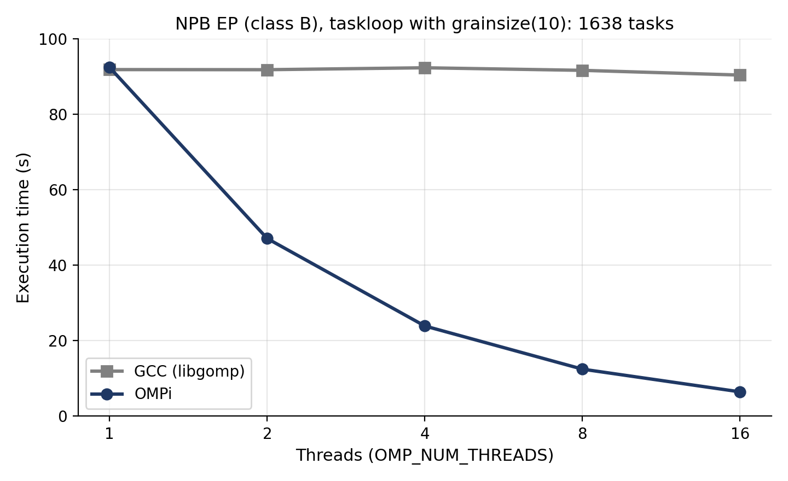

# OpenMP `taskloop` for the OMPi compiler

Implementation of the OpenMP `taskloop` directive in **OMPi**, an open-source source-to-source OpenMP compiler for C, together with a clause-by-clause test suite and a performance comparison against GCC on NAS Parallel Benchmarks.

Diploma thesis, Department of Computer Science & Engineering, University of Ioannina (October 2026).
Supervisor: Prof. Vasileios Dimakopoulos. Author: George Tsiknas.

## What this is

OMPi translates C code with OpenMP `#pragma`s into multithreaded C that a normal compiler (e.g. GCC) can build. It supported most of OpenMP 5.1 but not `taskloop`, which splits the iterations of a loop into tasks that are scheduled dynamically. This work adds it.

## How it works

1. **Parsing.** The parser recognises `taskloop` and its clauses and builds the matching AST node (an `OMPSTMT` node with a clause list, next to the `FOR` node of the loop).
2. **Transformation.** A new `xform_taskloop()` does not generate final code itself. It rewrites the `taskloop` node into an equivalent `task` node and hands it to the existing `xform_task()`, so `taskloop` reuses OMPi's task creation and queueing instead of adding a second mechanism. The loop becomes a serial *spawner* that creates `ntasks` tasks inside an implicit `taskgroup`; each task computes its own iteration range:

   ```c
   /* before */
   #pragma omp taskloop grainsize(g)
   for (i = 0; i < N; i++) body(i);

   /* after (simplified) */
   #pragma omp taskgroup
   {
     niters = N;
     ntasks = _ort_get_taskloop_ntasks(niters, 0, g);
     for (tid = 0; tid < ntasks; tid++)            /* spawner */
       #pragma omp task firstprivate(tid, ntasks)
       {
         _ort_get_taskloop_chunk(tid, ntasks, niters, &fiter, &liter);
         for (iter = fiter, i = fiter; iter < liter; iter++, i++)
           body(i);
       }
   }
   ```
3. **Runtime library.** Two functions were added to `libort`:
   - `_ort_get_taskloop_ntasks()` computes the number of tasks from `num_tasks`, `grainsize`, or (if neither is given) the number of threads.
   - `_ort_get_taskloop_chunk()` computes the iteration range of one task from its `tid` alone. With `chunk_size = floor(niters / ntasks)` and `r = niters mod ntasks`, the first `r` tasks take one extra iteration, so task sizes differ by at most one and tasks need no shared state.

### Supported clauses

`grainsize`, `num_tasks`, `shared`, `private`, `firstprivate`, `lastprivate`, `default`, `if`, `final`, `collapse`, `nogroup`, `reduction`, `in_reduction`, `priority`, `untied`, `mergeable`.

- `reduction` is turned into `task_reduction` on an enclosing `taskgroup` plus `in_reduction` on the tasks. `reduction` together with `nogroup` is rejected at compile time.
- `lastprivate` is copied back by the task that runs the last iteration.
- `collapse` is used to count the iterations of the merged loop nest.

**Not implemented:** the `allocate` clause (OMPi has no allocator infrastructure yet) and the `strict` modifier of `grainsize` / `num_tasks`.

## Tests

Twelve test programs, each covering one or more clauses. A test passes if and only if the program finishes normally; it calls `abort()` on any mismatch. `taskloop_default.c` is the exception: it checks that the compiler reports an error when `default(none)` is used without explicit data-sharing clauses.

| File | Covers |
|---|---|
| `taskloop_grainsize.c`, `taskloop_num_tasks.c`, `taskloop_default_implementation.c` | number of tasks created |
| `taskloop_data_sharing.c` | `lastprivate`, `shared`, `private`, `firstprivate` |
| `taskloop_default.c` | `default(none)` (expects a compile error) |
| `taskloop_final.c`, `taskloop_if.c` | `final`, `if` |
| `taskloop_collapse.c` | `collapse(2)` with `num_tasks(20)` |
| `taskloop_nogroup.c` | `nogroup` |
| `taskloop_reduction.c`, `taskloop_in_reduction.c` | `reduction`, `in_reduction` |
| `taskloop_suggestion_clauses.c` | `priority`, `untied`, `mergeable` (accepted, loop completes) |

To inspect the generated C, compile with `ompicc -k`, which keeps the intermediate file.

## Results: NAS Parallel Benchmarks

To evaluate the implementation on realistic workloads, two programs from the **NAS Parallel Benchmarks (NPB)** were used. NPB is NASA's reference suite of HPC benchmarks; this work uses its C/OpenMP version (NPB 3.0).

- **EP** (class B): "embarrassingly parallel", independent computations with almost no communication.
- **MG** (class C, 512 x 512 x 512 grid): a multigrid kernel.

The main loops of both programs were converted from `omp for` to `taskloop`, with the number of tasks set explicitly through `grainsize` / `num_tasks` so that it does not depend on the thread count. Each program was run with OMPi and with GCC (both using `taskloop`), and with OMPi's own `for` version, to measure the extra cost of `taskloop`.

Setup: Intel Xeon Silver 4314 (16 cores, 32 threads), AlmaLinux 9.4, GCC 11.5.0. OMPi and GCC were built with the same flags (`-O3 -fstrict-aliasing`). Threads pinned with `OMP_PLACES=cores`, `OMP_PROC_BIND=true`; 1, 2, 4, 8 and 16 threads; median of 5 runs; every run passed the benchmark's own verification.

| | OMPi vs GCC (both `taskloop`) | OMPi `taskloop` vs OMPi `for` |
|---|---|---|
| EP, `grainsize(256)` (64 tasks) | within 0.9 % | within 0.5 % |
| MG, `num_tasks(64)` | -1.0 % to +1.2 % | +0.7 % to +2.1 % |

EP reaches a speedup of 14.3 on 16 threads with OMPi (14.2 with GCC), about 89 % parallel efficiency. MG scales less: with 64 tasks OMPi goes from 27.4 s on 1 thread to 14.1 s on 16 threads, and with 1024 tasks to 10.5 s.

### Finding: GCC's `taskloop` stops scaling above 64 tasks per thread

In the GCC 11 `libgomp` (`libgomp/taskloop.c`), `GOMP_taskloop` checks `team->task_count + num_tasks > 64 * team->nthreads`. When it holds, the tasks are not queued but run one after another by the thread that met the `taskloop`. With more tasks than that limit, GCC lost its parallelism, while OMPi did not:



*NPB EP (class B), `taskloop` with `grainsize(10)` (1638 tasks): execution time against the number of threads (median of 5 runs).*

| EP, `grainsize(10)` (1638 tasks), seconds | 1 | 2 | 4 | 8 | 16 |
|---|---|---|---|---|---|
| GCC | 91.80 | 91.77 | 92.28 | 91.60 | 90.35 |
| OMPi | 92.38 | 47.06 | 23.89 | 12.46 | 6.45 |

| MG, `num_tasks(1024)`, seconds | 1 | 2 | 4 | 8 | 16 |
|---|---|---|---|---|---|
| GCC | 26.87 | 26.68 | 24.04 | 11.24 | 10.34 |
| OMPi | 27.37 | 17.22 | 13.19 | 11.42 | 10.50 |

### Limitations

- Only two benchmarks, both with roughly uniform iterations. The load-balancing benefit of `taskloop` for iterations of uneven cost was **not** measured.
- The overhead for very small tasks was not examined.
- Measurements go up to 16 threads (the physical cores).

## References

- V. V. Dimakopoulos, E. Leontiadis, G. Tzoumas, "A portable C compiler for OpenMP V.2.0", 5th European Workshop on OpenMP (EWOMP 2003).
- OpenMP Architecture Review Board, OpenMP Application Programming Interface, Version 5.1, 2020.
- NAS Parallel Benchmarks, C/OpenMP version: <https://github.com/benchmark-subsetting/NPB3.0-omp-C>
- GCC 11 `libgomp/taskloop.c`: <https://gnu.googlesource.com/gcc/+/refs/heads/releases/gcc11/libgomp/taskloop.c>
